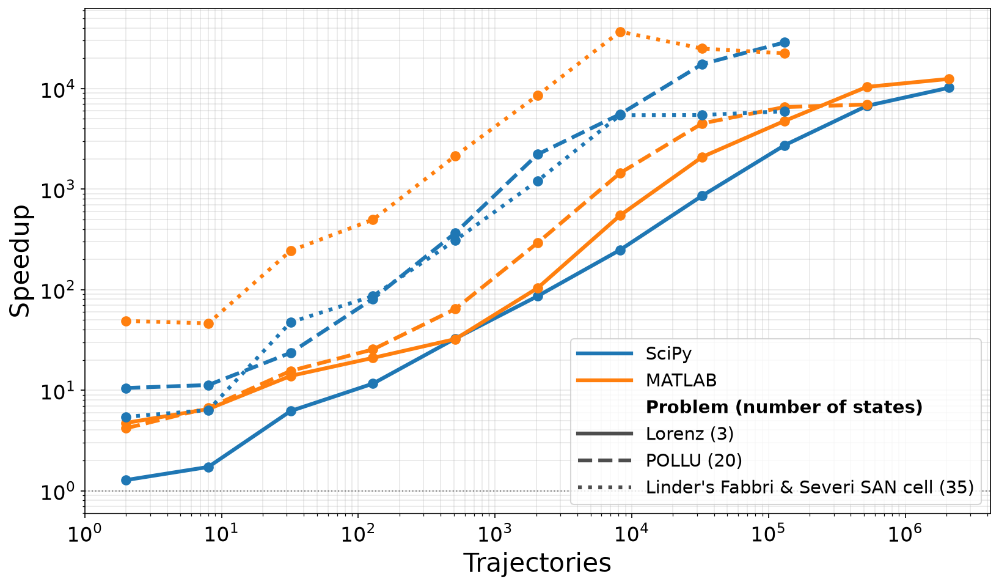

# Cubie

## CUDA Batch Integration Engine


Cubie solves large batches of ODEs and DAEs on your computer's NVIDIA GPU. It's as easy to use as SciPy or MATLAB - you write your problem in Python and call `solve_ivp` on it. For a guide on converting your MATLAB or SciPy problem to Cubie, check out the guides [link to docs pages for coming from matlab, coming from scipy]. 

Cubie compiles your system of equations into a GPU kernel that integrates every trajectory in
a batch of initial values or parameter sets in parallel. Because GPUs are so good at parallel workloads, a batch of ten thousand or so trajectories takes about as long as a batch of one. 


Cubie runs much faster than SciPy's `solve_ivp` or MATLAB's `ode45/ode23s`, even when you run them in parallel on the CPU. Cubie's advantage grows as you increase batch size, up to a plateau somewhere around 10,000x faster. 



These numbers were obtained running the same batch of parameters on the same ODE systems, with MATLAB running the Lorenz system in a parfor loop using ODE45, and the Pollution and Fabbri cell [link to cellml model/paper] using `ode23s`. Scipy used RK45 on the Lorenz system, and Radauiia5[whatever sciptys name is as code]. Both MATLAB and SciPy were given a helping hand by using Cubie's generated symbolic Jacobian for the stiff systems, and SciPy's RHS got JIT compiled through numba, to give them a fighting chance.

Under the hood, cubie uses [`numba-cuda-mlir`](https://github.com/NVIDIA/numba-cuda-mlir) to compile
the integration algorithms and your provided ODE/DAE systems into GPU code
and ferry your data in between your computer and GPU. It goes fast because it strips as much data from the GPUs memory as it can, instead compiling it into the code that the GPU runs.

[[2x comparison plots - to be rendered]]

It's the fastest parallel integrator I've found. Similar work has been done in parallel, for JAX on Linux, by GradSolve and Modax [[link these]], in Julia by DiffEqGPU.jl, and in higher-level systems Diffrax and TorchDiffEq[[link all]]. Cubie held its own, at the time of measurement. For large systems and implicit algorithms, it really shines.

## Capabilities

### Solve huge batches

- Give Cubie the ranges you want to explore, and it will build and run every combination of them.
- Calculate summary metrics during integration (averages, statistics, derivatives, etc)
and discard the trajectories, so you keep only what you need and fit more
runs into each solve.
- Save only the variables you need at the times you want them.
- If the results you want are still bigger than your computer's RAM or GPU's VRAM, Cubie chops it up into batches and gets it done without complaining.
- Rerun solvers cheaply - compiled kernels are cached for future use.
- Get results as NumPy arrays or pandas DataFrames.

### Bring your model

- Define ODE and DAE systems as equation strings, Python functions, SymPy
expressions, or CellML 1.0/1.1 models.
- Force your system with functions of time in its equations, or with arbitrary sampled
(measured) signals which Cubie interpolates on the GPU.
- Structurally simplify DAEs with alias elimination, index reduction and
tearing before Cubie generates solver code.

### Choose your solver

- Cubie has a large range of Runge-Kutta methods available to pick from:
    - Explicit:
    - Diagonally-Implicit:
    - Fully Implicit:
    - Rosenbrock-W:

### Customise (if you want to)

- Most inner details of the algorithms, step-size controllers, norms, solvers, etc are exposed as arguments, so if you're coming from an exhaustive differential equation suite like SciML's DifferentialEquations.jl, or you are deeply familiar with numerical integration and want to optimise, you can get your hands dirty.


## Installation

```console
pip install "cubie[cuda13]"
```

The extra in square brackets installs a CUDA toolkit: `cuda13` for CUDA 13,
`cuda12` for CUDA 12. Without it, `pip install cubie` finds whatever CUDA toolkit you have installed. If this means nothing to you, use `cuda13`.


## Requirements

[[make this a bulleted list]]
Include OS linux, windows
Cubie requires Python 3.11-3.14, an up-to-date NVIDIA driver, and an NVIDIA GPU
with compute capability 6.0 or later. Pandas and Matplotlib support can be installed with
`pip install "cubie[optional]"`.

## Quick start

```python
import numpy as np
from cubie import create_ODE_system, solve_ivp


system = create_ODE_system(
    ["dx = v", "dv = mu * (1 - x*x) * v - x"],
    states={"x": 1.0, "v": 0.0},
    parameters={"mu": 1.5},
)

result = solve_ivp(
    system,
    y0={"x": np.linspace(1.0, 2.0, 1024)},
    parameters={"mu": np.linspace(1.0, 3.0, 1024)},
    duration=20.0,
)
```

Cubie integrates all 1,048,576 combinations of the 1,024 initial values of
`x` and the 1,024 values of `mu`, starting `v` from its default of 0.0.
On an RTX 4070 SUPER, Cubie takes about 1s to compile and run it for the first
time. Once it's compiled once, every future batch takes 30 to 45 ms, in the 
same and future sessions.

## Documentation

The [documentation](https://cubiepy.github.io/cubie/) covers system creation,
batching, solver configuration, outputs, and performance.

## Acknowledgements

- [**SciML, DifferentialEquations.jl**](https://docs.sciml.ai/DiffEqDocs/stable/)
— SciML's differential equations ecosystem was the main reference for every
correctness, step-control, algorithm detail, or default constant question I
ran into when building Cubie. Cubie's implementation differs a lot, mostly
due to it's GPU-first nature, but almost every piece of math and many default
settings values were either drawn from or rigorously checked against a SciML
implementation.
The DAE initialiser is ported directly from OrdinaryDiffEq.jl under an MIT
license, as was some code in the DAE structural simplification pipeline.
. Any solving of DAEs through Cubie should cite them directly: See
[Rackauckas and Nie (2017)](https://doi.org/10.5334/jors.151).
If you want to explore numerical integration further, head to their docs,
where they have many accessibly-written explanations of which algorithms
do what well.
- [**ModelingToolkit.jl**](https://docs.sciml.ai/ModelingToolkit/stable/) —
Cubie's DAE tearing and structural-simplification implementation is largely
a direct port of ModelingToolkit.jl's approach, adapted to Cubie's symbolic
IR and CUDA code generation. DAE users should cite them directly as well: See
[Ma et al. (2021)](https://doi.org/10.48550/arXiv.2103.05244).
- **[cellmlmanip](https://github.com/ModellingWebLab/cellmlmanip) and
[chaste_codegen](https://github.com/ModellingWebLab/chaste-codegen)** — Their
work is used to import CellML models and detect and repair removable
singularities in Goldman-Hodgkin-Katz-style equations. See
[Hendrix et al. (2022)](https://doi.org/10.12688/wellcomeopenres.17206.2).

## License

MIT (`LICENSE`); third-party notices in `THIRD_PARTY_LICENSES`.

## Contributing

Pull requests are welcome. Please open an issue before starting a major change
so that the design can be discussed first.