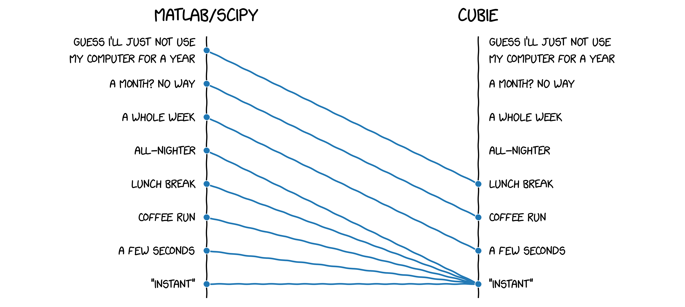

# CuBIE

## CUDA Batch Integration Engine for Python

[](https://github.com/cubiepy/cubie/actions/workflows/documentation.yml)
[](https://github.com/cubiepy/cubie/actions/workflows/ci_cuda_tests.yml)
[](https://github.com/cubiepy/cubie/actions/workflows/ci_nocuda_tests.yml)
[](https://codecov.io/gh/cubiepy/cubie)


CuBIE solves batches of ODEs and DAEs on NVIDIA GPUs, from thousands to
millions of trajectories at a time. Write your system as equations in
Python and call `solve_ivp` as you would in SciPy or MATLAB. CuBIE compiles
the system and the solver into a GPU kernel, integrates every trajectory in
parallel, and finishes over lunch a batch that would keep your CPU busy for
a year.



On large batches, CuBIE runs around 10,000 times faster than SciPy's
`solve_ivp` or MATLAB's `ode45`, even when you spread the CPU runs across
20 workers. CuBIE pulls further ahead as the batch grows: it runs a few
times faster for a handful of trajectories, and around 10,000 times faster
for hundreds of thousands or millions.


<sub>We timed CuBIE from host arrays to host arrays on an RTX 4070 SUPER, and
SciPy and MATLAB on an i7-12700 with 20 workers. We gave the implicit CPU
solvers analytic Jacobians and compiled SciPy's right-hand sides with numba.
We ran everything at rtol = atol = 1e-5.</sub>

Under the hood, cubie uses [`numba-cuda-mlir`](https://github.com/NVIDIA/numba-cuda-mlir) to compile
python integration algorithms and your provided ODE/DAE systems into GPU code
and ferry your data in between your computer and GPU. Python-side, it generates Jacobian-vector 
product (JVP), residual, and preconditioner functions from your system of equations and folds those into
iterative linear or nonlinear solvers (depending on the algorithm you choose) which are compiled
into the final kernel. By treating the core math as code instead of evaluating it per-step,
cubie achieves a low memory footprint on the GPU, allowing you to fit more integrations
onto it at once. 


## Capabilities

### Solve huge batches

- Sweep every combination of your parameter and initial values, or pair them
  run for run, in a single call.
- Calculate summary metrics on the GPU (mean, standard deviation, RMS,
  minimum, maximum, peaks, and extrema of the first and second derivatives)
  and discard the trajectories, so you keep only what you need and fit more
  runs into each solve.
- Save only the states and observables you choose.
- Solve batches bigger than your GPU or your computer's RAM: CuBIE divides
  them into chunks that fit.
- Pay the compile time once per configuration: CuBIE caches compiled solvers
  between sessions.
- Get results as NumPy arrays or pandas DataFrames.

### Bring your model

- Define ODE and DAE systems as equation strings, Python functions, SymPy
  expressions, or CellML 1.0/1.1 models.
- Force your system with functions of time in its equations, or with sampled
  (measured) signals.
- Structurally simplify DAEs with alias elimination, index reduction and
  tearing before CuBIE generates solver code. CuBIE ports this logic almost
  verbatim from [ModelingToolkit.jl](https://github.com/SciML/ModelingToolkit.jl).

### Choose your solver

- Integrate with explicit Runge-Kutta (Tsit5 by default), diagonally
  implicit Runge-Kutta, fully implicit Runge-Kutta, and Rosenbrock-W
  methods, with fixed or adaptive steps.

## Installation

```console
pip install "cubie[cuda13]"
```

The extra in square brackets installs a CUDA toolkit: `cuda13` for CUDA 13,
`cuda12` for CUDA 12. Without it, `pip install cubie` uses a system CUDA install.

CuBIE requires Python 3.11-3.14, an up-to-date NVIDIA driver, and an NVIDIA GPU
with compute capability 6.0 or later. Pandas and Matplotlib support can be installed with
`pip install "cubie[optional]"`.

## Quick start

```python
import numpy as np
from cubie import create_ODE_system, solve_ivp


system = create_ODE_system(
    ["dx = v", "dv = mu * (1 - x*x) * v - x"],
    states={"x": 1.0, "v": 0.0},
    parameters={"mu": 1.5},
)

result = solve_ivp(
    system,
    y0={"x": np.linspace(1.0, 2.0, 1024)},
    parameters={"mu": np.linspace(1.0, 3.0, 1024)},
    duration=20.0,
)
```

CuBIE integrates all 1,048,576 combinations of the 1,024 initial values of
`x` and the 1,024 values of `mu`, starting `v` from its default of 0.0.
On an RTX 4070 SUPER, CuBIE spends about 2 s compiling the CUDA kernels for
your first solve and caches them on disk. In a later session, CuBIE loads
the cached kernels and finishes your first solve in about 0.1 s. CuBIE
finishes every repeat solve in 30 to 45 ms.

## Documentation

The [documentation](https://cubiepy.github.io/cubie/) covers system creation,
batching, solver configuration, outputs, and performance.

## Acknowledgements

- **[SciML, DifferentialEquations.jl](https://docs.sciml.ai/DiffEqDocs/stable/)**
  — SciML's differential equations ecosystem was the main reference for every
  correctness, step-control, algorithm detail, or default constant question I
  ran into when building Cubie. Cubie's implementation differs a lot, mostly
  due to it's GPU-first nature, but almost every piece of math and many default
  settings values were either drawn from or rigorously checked against a SciML
  implementation.
  The DAE initialiser is ported directly from OrdinaryDiffEq.jl under an MIT
  license, as was some code in the DAE structural simplification pipeline.
  . Any solving of DAEs through Cubie should cite them directly: See
  [Rackauckas and Nie (2017)](https://doi.org/10.5334/jors.151).
  If you want to explore numerical integration further, head to their docs,
  where they have many accessibly-written explanations of which algorithms
  do what well.
- **[ModelingToolkit.jl](https://docs.sciml.ai/ModelingToolkit/stable/)** —
  CuBIE's DAE tearing and structural-simplification implementation is largely
  a direct port of ModelingToolkit.jl's approach, adapted to CuBIE's symbolic
  IR and CUDA code generation. DAE users should cite them directly as well: See
  [Ma et al. (2021)](https://doi.org/10.48550/arXiv.2103.05244).
- **[cellmlmanip](https://github.com/ModellingWebLab/cellmlmanip) and
  [chaste_codegen](https://github.com/ModellingWebLab/chaste-codegen)** — Their
  work is used to import CellML models and detect and repair removable
  singularities in Goldman-Hodgkin-Katz-style equations. See
  [Hendrix et al. (2022)](https://doi.org/10.12688/wellcomeopenres.17206.2).

## License

MIT (`LICENSE`); third-party notices in `THIRD_PARTY_LICENSES`.

## Contributing

Pull requests are welcome. Please open an issue before starting a major change
so that the design can be discussed first.
